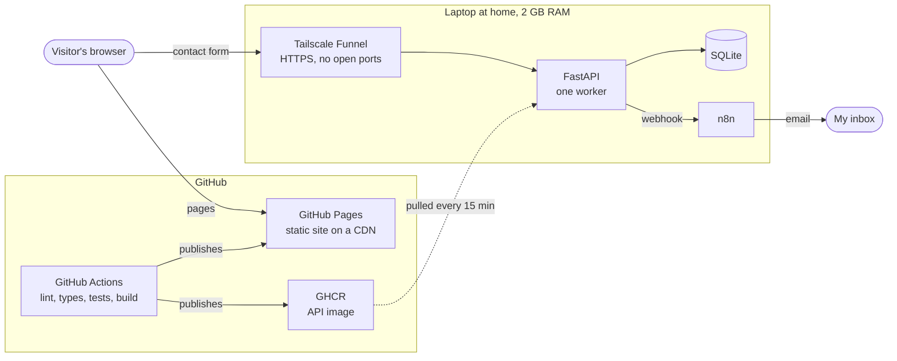

# jjduques.github.io

The portfolio of Juan Duque, a backend-focused Software Engineer. The site is live at **[jjduques.github.io](https://jjduques.github.io)**, in English and [in Spanish](https://jjduques.github.io/es/).

The site is also a working example of how I build software. The pages are static files on a CDN. A small API runs on a 2014 laptop with 2 GB of RAM in my house. Every decision behind that split is written down, with what it costs.


## How it fits together



- **Pages**: Next.js exported as static files, served by GitHub Pages. They stay up when the laptop is off.
- **Contact form**: the browser posts straight to the API, which Tailscale Funnel publishes over HTTPS from the laptop.
- **API**: saves the message in SQLite first, then asks n8n to email it. If n8n is down, it retries later, so no message is lost.
- **Nothing is built on the laptop**: CI builds the site and the API image, and the laptop only pulls the image.

## Stack

| Part | Built with |
| --- | --- |
| Frontend | Next.js (App Router, static export), React, TypeScript, Tailwind CSS, Motion |
| Content | Markdown and JSON validated with Zod at build time, in English and Spanish |
| API | Python 3.13, FastAPI, Pydantic, SQLite (standard library, no ORM) |
| Infrastructure | Docker Compose, Tailscale Funnel, n8n, GitHub Actions, GitHub Pages, GHCR |
| Tests | Vitest (unit tests and checks on the exported site), pytest |

## What's worth a look

- **The hero animation is real data.** It replays the visitor's own request, timed by the browser's Navigation Timing API ([`frontend/components/live-flow.tsx`](frontend/components/live-flow.tsx)).
- **The API fits in about 60 MB.** It is one worker with an in-memory rate limit, a honeypot, a 16 KB body cap, CORS for the site only, and no IPs stored ([`api/app/main.py`](api/app/main.py)).
- **Save first, notify after.** A failed email never loses a message, and failures explain themselves in the log ([`api/app/notify.py`](api/app/notify.py)).
- **The site checks itself.** The tests run against the exported HTML: every internal link resolves, every page has its own Open Graph tags, and no phone number is ever published ([`frontend/tests/build.test.ts`](frontend/tests/build.test.ts)).
- **Two languages, no translation script.** Each language has its own root layout and `<html lang>`, every page links to its counterpart with `hreflang`, and the visitor's choice is remembered without ever redirecting on a guess ([`frontend/lib/i18n.ts`](frontend/lib/i18n.ts), [ADR 0005](docs/adr/0005-spanish-version-under-es.md)).
- **The build refuses a broken API URL**, such as an address that only exists on the laptop ([`frontend/lib/api-url.ts`](frontend/lib/api-url.ts)).

## Decisions

Each one is an [Architecture Decision Record](docs/adr) with its context, trade-offs and the alternatives I considered:

1. [Astro with React islands](docs/adr/0001-astro-with-react-islands.md), superseded by 0003
2. [Static frontend on GitHub Pages, API on the laptop](docs/adr/0002-static-frontend-on-github-pages.md)
3. [Next.js, React and Tailwind for the frontend](docs/adr/0003-nextjs-react-tailwind.md)
4. [The API on the laptop, exposed with Tailscale Funnel](docs/adr/0004-api-on-laptop-with-tailscale-funnel.md)
5. [A Spanish version under /es/, written rather than machine-translated](docs/adr/0005-spanish-version-under-es.md)

## Repository

```
frontend/   Next.js site: app/(en) and app/(es) routes, components/, content/, lib/i18n.ts, tests/
api/        FastAPI service: app/, migrations, tests/, Dockerfile
deploy/     Compose file, update and backup scripts, laptop setup guide
docs/adr/   Architecture Decision Records
```

## Run it locally

```bash
# Site, at http://localhost:3000
cd frontend
npm ci
npm run dev

# API, at http://127.0.0.1:8000/api/docs
cd api
uv venv -p 3.13 && . .venv/bin/activate
uv pip install -e ".[dev]"
DATABASE_PATH=./dev.db CORS_ORIGINS=http://localhost:3000 uvicorn --factory app.main:create_app --reload
```

To see the contact form work against the local API, start the site with `NEXT_PUBLIC_API_URL=http://127.0.0.1:8000 npm run dev`. The build only accepts a public HTTPS URL. Checks: `npm run lint && npm run build && npm test` in `frontend`, and `ruff check . && pytest` in `api`.

## Deploy

- **Site**: every push to `main` that passes lint, type checks, build and tests is published to GitHub Pages by [`.github/workflows/ci.yml`](.github/workflows/ci.yml). The `API_URL` repository variable holds the API's public URL.
- **API**: the same workflow publishes `ghcr.io/jjduques/portfolio-api`. The laptop runs it with Docker Compose. Setup, n8n, Funnel, backups and troubleshooting are in [`deploy/README.md`](deploy/README.md).

## Contact

[LinkedIn](https://www.linkedin.com/in/jduques/), or the form on [jjduques.github.io](https://jjduques.github.io/#contact).
